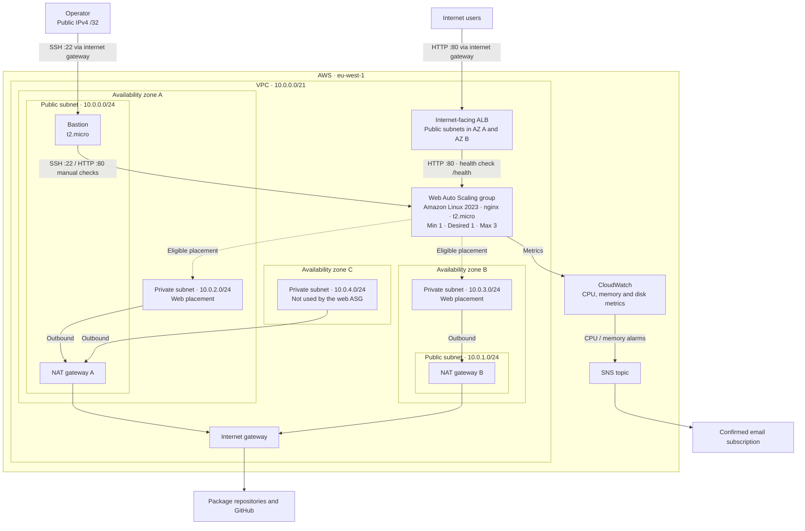

# SRE exercise

A small AWS web application built with Terraform and Ansible. An internet-facing
Application Load Balancer serves a **Hello, World!** page from an Auto Scaling
group in private subnets. GitHub Actions validates and plans changes, waits for
approval, applies the saved plan, and tests the public endpoint.

**Start here:** [Architecture](#architecture) ·
[Repository layout](#repository-layout) ·
[Making changes](#making-changes) ·
[Deploy](#deploy-from-a-fresh-clone) ·
[CI/CD](#github-actions) ·
[Testing](#test-and-inspect-the-deployment) ·
[Costs](#cost-and-scope) · [Cleanup](#cleanup)

## Architecture

### Resource ownership

| Layer | Manages |
|---|---|
| Foundation | VPC, public/private subnets, internet gateway, NAT gateways and routes |
| GitHub Actions IAM | GitHub OIDC provider, deployment role and deployment policies |
| Application infrastructure | ALB, target group, web ASG, bastion, instance profile and monitoring |
| Ansible | nginx installation, HTML page, health endpoint and service configuration |

### Network and request paths



Solid arrows show traffic or telemetry; dotted arrows show where the ASG can
place instances, not additional running servers. The ALB spans both public
subnets. AZ A/B/C denote the availability zones selected by the foundation.

The foundation provides two public and three private `/24` subnets. The web group
uses only private subnets in availability zones enabled on the ALB, so each web
instance can receive traffic. The third private subnet remains available for
other workloads. The default desired capacity is one: the network spans multiple
zones, but the application does not have redundant instances at that capacity.

The bastion is an administration path, not part of the application's request
path. Web instances have no public IP.

### Network access

| Destination | Port | Allowed source |
|---|---|---|
| ALB | TCP 80 | Internet |
| Bastion | TCP 22 | Operator's public IPv4, supplied as a `/32` |
| Web instances | TCP 22 | Bastion security group |
| Web instances | TCP 80 | ALB and bastion security groups |

The exercise asks for HTTP from the bastion only and also requires an ALB.
The web ingress rules allow both security groups so the ALB can forward requests
and perform health checks. Bastion outbound rules permit SSH and HTTP to the web
security group, plus HTTPS to external services. HTTP from the bastion is for
direct checks over the instances' private IPs; users access the page through the ALB.

SSH uses an existing EC2 key pair. The bootstrap scripts disable root and password
SSH login, require IMDSv2, and install the CloudWatch agent. Root volumes are
encrypted. Both instance types share an instance profile with the AWS-managed
SSM and CloudWatch agent policies; neither uses static AWS credentials.

## Repository layout

```text
sre-exercise/
|-- terraform.d/                      Infrastructure root module
|   |-- main.tf                       Calls ./modules
|   |-- data.tf                       Reads foundation state
|   |-- provider.tf, versions.tf      Provider and Terraform requirements
|   |-- variables.tf, terraform.tfvars
|   |-- state.tf, terraform.backend-config.tfvars
|   |-- outputs.tf
|   |-- modules/                      One child module, split by component
|   |   |-- alb.tf, asg.tf, bastion.tf
|   |   |-- security_groups.tf, iam.tf, monitoring.tf
|   |   |-- data.tf, user_data.tf
|   |   |-- user_data_common.sh.tftpl  SSH configuration and CloudWatch agent
|   |   |-- user_data_web.sh.tftpl     Ansible installation and ansible-pull
|   |   `-- variables.tf, outputs.tf, versions.tf
|   |-- foundation/                   Separate root: network resources
|   `-- github_actions_iam/           Separate root: CI identity and policies
|-- ansible.d/
|   |-- ansible.cfg
|   |-- playbooks/web.yml
|   `-- roles/web/
|       |-- tasks/main.yml
|       |-- handlers/main.yml
|       `-- templates/index.html.j2
|-- .github/workflows/
|   |-- deploy-infra.yaml             Deployment orchestration
|   |-- detect-changes.yaml           Foundation-only change detection
|   `-- reusable-tf-apply.yaml        Plan, approval, apply and smoke test
`-- README.md
```

Each root module has its own state object:

| Working directory | S3 state key |
|---|---|
| `terraform.d/foundation` | `foundation/terraform.tfstate` |
| `terraform.d/github_actions_iam` | `github-actions-iam/terraform.tfstate` |
| `terraform.d` | `infrastructure/terraform.tfstate` |

The child module has no backend or provider configuration. The infrastructure
root reads the network IDs from foundation state and passes them as inputs.
See the [module call](terraform.d/main.tf),
[application resources](terraform.d/modules/),
[network resources](terraform.d/foundation/) and
[Ansible role](ansible.d/roles/web/).

State locking is not enabled. Run only one plan/apply/destroy sequence against a
given state at a time, including local commands and pending CI deployments.

## Application deployment

Every web instance configures itself at boot:

1. Cloud-init runs the launch template's user data.
2. The shared script configures SSH and starts the CloudWatch agent.
3. The web script installs Git and Ansible, then runs `ansible-pull`.
4. The playbook installs nginx, writes the HTML page and `/health`, and enables
   the service.

This also configures instances launched later by scaling, without a separate CI
push to those hosts. The public repository is fetched from `ansible_repo_branch`
(`main` by default); that branch must exist and contain the Ansible files.
Bootstrap therefore depends on outbound package and GitHub access.

A hash of the local Ansible files is included in user data. Ansible edits change
the launch template even when its repository URL stays the same.

### Changes to running instances

Launch template version changes replace the web ASG. Terraform creates a
uniquely named replacement group first and waits for the configured number of
its instances to become healthy in the target group. With the defaults, this is
one instance, with a ten-minute timeout. It then removes the old group.

`replace_triggered_by` ties replacement to the launch template version;
`create_before_destroy` keeps the existing group until the replacement is ready.
Both groups share the target group during cutover, with temporary extra capacity.
A timeout fails apply and requires inspection of any partially created resources;
Terraform does not automatically roll the release back.

The ALB checks `/health` for HTTP 200. The smoke test separately checks the home
page for `Hello, World!`.

## Making changes

Create a feature branch, update the relevant files, review the Terraform plan,
and open a pull request.

| Change | Where | Deployment effect |
|---|---|---|
| Page content | [HTML template](ansible.d/roles/web/templates/index.html.j2) | Ansible hash changes user data; replaces the web ASG |
| Instance type | `instance_type` in [root inputs](terraform.d/terraform.tfvars) | Updates both bastion and web instance type; the web ASG is replaced |
| Scaling bounds or initial capacity | `asg_min_size`, `asg_max_size`, `asg_desired_capacity` in root inputs | Updates the ASG in place |
| CPU target and CPU alarm | `cpu_alarm_threshold` in root inputs | Updates the scaling policy and notification alarm |
| Memory alarm or email address | `memory_alarm_threshold`, `alert_email` in root inputs | Updates monitoring; a new email subscription needs confirmation |
| Operator SSH address | GitHub Actions secret `ADMIN_CIDR`, or local `TF_VAR_admin_cidr` | Updates bastion SSH ingress on the next apply |
| Instance bootstrap | [user-data templates](terraform.d/modules/) | Web user data replaces the ASG; shared user data also replaces the bastion |
| Network resources | [foundation root](terraform.d/foundation/) | Deploys foundation before infrastructure; review network replacement effects |

Defaults are declared in [root variables](terraform.d/variables.tf). Override
deployment-specific settings in root inputs, and change resource behaviour in
the child module. Keep the foundation, root `state_bucket` input, IAM inputs and
backend configurations consistent if changing the state location.

Ansible changes must be available on `ansible_repo_branch` when instances boot.
For the normal merge-to-main flow, both Terraform and Ansible changes are merged
together before deployment. A plan's content hash triggers replacement but does
not pin the later Git checkout to a commit.

## Deploy from a fresh clone

### Prerequisites

- Terraform **1.15.9**: the foundation and IAM roots require that exact version.
  The infrastructure root allows the wider `~> 1.15` range.
- AWS provider **6.49.0** in the foundation and IAM roots; the infrastructure
  root uses `~> 6.49`. Terraform installs providers during `init`.
- AWS CLI v2 and an authenticated identity in the intended account.
- An existing EC2 key pair in `eu-west-1`; the configured name is
  `sre-exercise-key-pair`. Keep its private key outside the repository.
- An existing S3 state bucket in `eu-west-1`. The supplied configurations use
  `sre-exercise-tf-state`; Terraform does not create this bucket.
- An email address for SNS notifications.

For a different account or fork, review the account IDs, region, backend bucket,
state-bucket inputs, GitHub owner/repository, Ansible URL, email, key pair and
workflow role ARN before applying. Providers reject accounts outside
`aws_account_id`. The repository assumes a public Ansible source.

The state bucket should have versioning, encryption and public access blocking.
Restrict its IAM access: state and saved plans can contain sensitive values.
S3 bucket names are globally unique, so a new deployment may need another name.
An existing GitHub OIDC provider in the account must be imported or reused rather
than created a second time.

### 1. Clone and authenticate

```bash
git clone https://github.com/mukkapati123/sre-exercise.git
cd sre-exercise

aws sso login --profile <your-profile>
export AWS_PROFILE=<your-profile>
export AWS_REGION=eu-west-1
aws sts get-caller-identity
```

Use your own configured AWS authentication method if it is not SSO. Verify the
account before proceeding. The commands below run from the repository root.

### 2. Review inputs

Review the `terraform.tfvars` and backend configuration in each root. Supply the
operator address separately, not in public source:

```bash
export TF_VAR_admin_cidr="<your-public-ipv4>/32"
```

Use the public address of the network from which you will SSH, not the laptop's
private address or a GitHub runner's address. The child module validates `/32`
IPv4 input. Update it when your network's public address changes.

### 3. Apply the network and GitHub IAM roots

```bash
terraform fmt -check -recursive terraform.d

terraform -chdir=terraform.d/foundation init -backend-config=terraform.backend-config.tfvars
terraform -chdir=terraform.d/foundation validate
terraform -chdir=terraform.d/foundation plan -out=tf.plan
terraform -chdir=terraform.d/foundation apply tf.plan

terraform -chdir=terraform.d/github_actions_iam init -backend-config=terraform.backend-config.tfvars
terraform -chdir=terraform.d/github_actions_iam validate
terraform -chdir=terraform.d/github_actions_iam plan -out=tf.plan
terraform -chdir=terraform.d/github_actions_iam apply tf.plan
```

Review each plan before applying. Use an administrative/bootstrap identity for
the IAM root; the CI deployment role is not intended to manage its own policies.

### 4. Apply the application infrastructure

```bash
terraform -chdir=terraform.d init -backend-config=terraform.backend-config.tfvars
terraform -chdir=terraform.d validate
terraform -chdir=terraform.d plan -out=tf.plan
terraform -chdir=terraform.d apply tf.plan
terraform -chdir=terraform.d output
```

Allow time for package installation and target registration. Confirm the SNS
subscription using the link AWS emails to `alert_email`; creation alone does
not enable email delivery.

## GitHub Actions

Use a feature branch and pull request for changes, then **squash merge** with the
PR title as the squash commit title. On pushes to `main`, the workflow checks the
latest commit title and skips deployment when it starts with `chore:`.
Use `chore:` for documentation-only maintenance that should not deploy, and
`feat:` or `fix:` for deployable changes. The check is literal: other prefixes,
including scoped or breaking-change `chore` forms, are not excluded.
Only the push's latest commit title is checked.

This is not currently a pull-request validation workflow. Run formatting,
validation and plan locally before merging.

Configure these repository settings before using CI:

| Setting | Purpose |
|---|---|
| Actions secret `ADMIN_CIDR` | Operator IPv4 in `/32` form, mapped to `TF_VAR_admin_cidr` |
| Environment `production` | Holds required-reviewer protection for apply jobs |
| Workflow role ARN | OIDC role created by the IAM root |

Enable required reviewers on `production`; naming an environment alone does not
provide approval. If the operator also approves deployments, ensure the
environment's self-review policy permits that.

```text
Push to main
    |
    v
Commit title starts with chore:? -- yes --> skip deployment
    |
    no
    |
    v
Detect foundation changes
    |
    +-- changed --> foundation plan --> approval --> foundation apply
    |                                                    |
    +-- unchanged ---------------------------------------+
                                                         |
                                                         v
                                  infrastructure fmt / init / validate / plan
                                                         |
                                               review saved plan
                                                         |
                                                  manual approval
                                                         |
                                               infrastructure apply
                                                         |
                                                   ALB smoke test
```

For eligible commits, foundation runs only when its directory changes.
Infrastructure is planned after foundation succeeds or is skipped. A run deploying both roots
has two approval gates. The IAM root is applied separately.

Plan and apply use separate jobs. The plan is published to the job summary and
saved as an artifact with one-day retention; apply downloads that plan instead
of generating a new one. AWS credentials are obtained through GitHub OIDC in
each job, with no stored AWS access keys. The trust policy allows the repository's
branch and environment subject formats, including GitHub's numeric ID suffixes.

**Saved plans are not secret storage.** In a public repository, users with read
access can download workflow artifacts after signing in. Do not introduce
passwords, tokens or other credentials into plans or summaries.

## Test and inspect the deployment

### Public application and target health

```bash
URL=$(terraform -chdir=terraform.d output -raw alb_url)
curl --fail "$URL/"
curl --fail "$URL/health"

TG=$(terraform -chdir=terraform.d output -raw target_group_arn)
aws elbv2 describe-target-health --target-group-arn "$TG" \
  --query 'TargetHealthDescriptions[].[Target.Id,TargetHealth.State,TargetHealth.Reason]' \
  --output table
```

The home page should contain `<h1>Hello, World!</h1>` and `/health` should return
`ok`. CI polls the public home page up to 60 times, with ten seconds between
attempts, and fails unless the expected text is present. On failure it reports
target health and recent ASG activity.

### Access and logs

SSM Session Manager is available through the instance profile, subject to agent
connectivity and the operator's IAM permissions. The CLI command also requires
the [Session Manager plugin](https://docs.aws.amazon.com/systems-manager/latest/userguide/session-manager-working-with-install-plugin.html)
on the laptop; alternatively, connect through the EC2 console:

```bash
aws ssm start-session --target <web-instance-id>
```

For SSH, use the current `bastion_public_ip` output. Keep the key on the laptop
and use ProxyJump; do not copy it to the bastion. For example, in local
`~/.ssh/config`:

```sshconfig
Host sre-bastion
    HostName <bastion-public-ip>
    User ec2-user
    IdentityFile ~/.ssh/sre-exercise-key-pair.pem

Host sre-web
    HostName <web-private-ip>
    User ec2-user
    IdentityFile ~/.ssh/sre-exercise-key-pair.pem
    ProxyJump sre-bastion
```

Then run `ssh sre-web`. On the instance:

```bash
sudo cloud-init status --long
sudo tail -100 /var/log/cloud-init-output.log
sudo systemctl status nginx --no-pager
curl --fail http://localhost/health
```

Cloud-init output stays on the host; it is not currently shipped to CloudWatch.
SSH auth logs are configured for `/sre-exercise/secure` with seven-day retention.
CloudTrail records AWS API activity, not ordinary SSH sessions.

### Monitoring and scaling

| Signal | Source | Configuration |
|---|---|---|
| CPU | `AWS/EC2`, `CPUUtilization` | Alarm above 70% |
| Memory | `CWAgent`, `mem_used_percent` | Alarm above 80% |
| Disk usage | CloudWatch agent | Collected for `/`; no disk alarm |
| Notifications | SNS email subscription | Alarm and return-to-OK notifications |

CPU and memory alarms use the ASG dimension, two five-minute evaluation periods,
and average statistics. Missing data is treated as non-breaching, so an OK alarm
alone does not prove telemetry is arriving. Check metric datapoints as well as
alarm state and confirm email delivery.

The scaling policy targets 70% average CPU, bounded by one to three web instances.
AWS manages the target-tracking alarms separately from the notification alarms.
For a controlled test, generate CPU load on a web instance, observe the metric
and ASG scaling activity, then stop the load and allow time for scale-in.
Monitoring intervals, warm-up and `t2.micro` CPU credits affect the timing.

## Cost and scope

This deployment uses an older AWS account, so the initial EC2/ALB/EBS Free Tier
allowances cannot be assumed. Free Tier eligibility depends on the account's
creation date, plan and remaining allowances, not just the instance type.

Cost controls in the configuration:

- One web instance at baseline; three is the scaling ceiling, not the normal count.
- Small encrypted 8 GiB gp3 root volumes, deleted on instance termination.
- Seven-day CloudWatch log retention.
- No database, container cluster or paid secret store for a static page.
- A cleanup sequence that removes compute and networking when the exercise ends.

The largest standing cost is the **two NAT gateways**. They provide separate
egress paths for the two web AZs and incur hourly, data-processing and public IPv4
charges. ALB hours and capacity, EC2, EBS, public IPv4 addresses, custom metrics
and logs also contribute. ASG replacement temporarily adds capacity.

For a lower-cost demo, one NAT would trade egress resilience for a smaller bill;
this would require updating NAT counts and private routes together. Destroying
the environment between demos removes more cost than stopping EC2 alone:
stopped instances do not eliminate NAT, ALB, EBS or retained-address charges.
Use the [AWS Pricing Calculator](https://calculator.aws/) with `eu-west-1` rates
and actual running hours rather than treating this architecture as free.

HTTPS certificates, WAF, immutable AMI builds, containerisation and Secrets
Manager integration are outside the current implementation. HTTP is used for
the exercise page; it is not a recommendation for handling sensitive traffic.
The instance role uses AWS-managed SSM/CloudWatch policies, rather than a custom
per-action policy, and is shared by bastion and web hosts.

## Cleanup

Cancel or finish pending deployments first. Use the same account, backend inputs
and operator variable as deployment. Inspect each destroy plan before applying.

```bash
# Application resources first, while foundation and CI IAM still exist.
terraform -chdir=terraform.d plan -destroy -out=destroy.plan
terraform -chdir=terraform.d apply destroy.plan

# Network resources, including NAT gateways and their Elastic IPs.
terraform -chdir=terraform.d/foundation plan -destroy -out=destroy.plan
terraform -chdir=terraform.d/foundation apply destroy.plan

# OIDC provider, deployment role and policies last, using bootstrap credentials.
terraform -chdir=terraform.d/github_actions_iam plan -destroy -out=destroy.plan
terraform -chdir=terraform.d/github_actions_iam apply destroy.plan
```

For a fresh checkout, initialise each root with its backend configuration before
running those commands. Terraform does not own the state bucket or the existing
key pair, so they remain. Do not remove a shared OIDC provider or other resources
still used by another deployment.

Check AWS for remaining instances, load balancers, NAT gateways, allocated
addresses, volumes and log groups. Retain state for recovery until cleanup is
confirmed. If the dedicated state bucket is no longer needed, remove it
separately, including historical object versions, only after all roots have been
destroyed and any required state backup has been secured.
